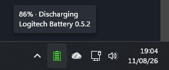
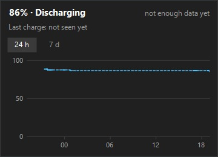
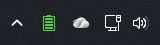

# Logitech Battery Indicator

A small Windows tray app that shows the battery level of Logitech devices, without Logitech G HUB. It is made for and tested with the **Logitech PRO X2 SUPERSTRIKE** mouse; other devices that report their battery the same way are read too.

The tray icon shows the charge at a glance; hover it for the exact percentage. The app reads the devices directly over Logitech's HID++ protocol, through their Lightspeed receivers or the USB cable.



> Not affiliated with or endorsed by Logitech. Logitech, Logitech G, G HUB, Lightspeed, Logi Options+ and PRO X2 SUPERSTRIKE are trademarks of Logitech.

## Features

- **Battery in the tray** – the icon shows the level and whether the device is charging; the tooltip shows the exact percentage.
- **Several devices** – every supported device on every receiver and cable is read, also two receivers of the same model. Each device has its own notifications and history; **Show in tray** chooses the one the icon shows, and the tooltip lists the others.
- **Instant updates** – the tray changes within about a second when a device sleeps, wakes, is switched off or on, or when the receiver or cable is plugged in or out.
- **Notifications** – a Windows notification when the battery is low (15 % by default, 10 % or 20 % in the tray menu), critical (5 %) and fully charged (can be switched off in the tray menu).
- **Start with Windows** – on by default, can be switched off in the tray menu. No admin rights needed.
- **History panel** – left-click the tray icon for a 24 h / 7 day graph of the battery level and the time of the last charge.
- **Time left** – an estimate of the hours left, based on how fast the battery drained over the last week.
- **Update notifications** – off by default. When you turn on "New app versions" in the Notifications menu, the app checks about 2 minutes after each start and then once a day while it runs, and tells you when a newer release exists. It never downloads or installs anything: a click opens the download page. **Check for updates…** in the tray menu checks once, when you ask.
- **Lightweight and private** – no installer, no background service, no account, no telemetry and no network access unless you turn on update notifications or choose Check for updates. Everything stays on your PC.



## Requirements

- Windows, 64-bit.
- A Logitech device that reports its battery with HID++ Unified Battery, connected through a Lightspeed receiver or a USB cable. Tested with the PRO X2 SUPERSTRIKE and the PRO X 2 mice, also both at once on two receivers. Bolt, Unifying and Bluetooth are not tested. A device that reports its battery another way appears in `log.txt` as `Skipping device … reason=noUnifiedBattery`; to ask for support, open an issue with its `--probe` report (see Troubleshooting).

No .NET installation is needed: the app is a single self-contained `.exe` (about 107 MB, because it contains the .NET runtime uncompressed; this keeps the app at about 12 MB of RAM instead of about 50 MB).

## Install

1. Download `LogitechBattery.exe` from the [latest release](https://github.com/fedemarco/logitech-battery-indicator/releases/latest).
2. Move it to a permanent folder, for example `%LOCALAPPDATA%\LogitechBattery`. "Start with Windows" remembers this location.
3. Run it. The battery icon appears in the tray (you may need to drag it out of the overflow area to keep it visible).

To check the download, put the `LogitechBattery.exe.sha256` file of the same release (from version 0.8.0) next to the exe and run this in that folder. It prints `True` when the file is intact:

```powershell
(Get-FileHash .\LogitechBattery.exe).Hash -eq (Get-Content .\LogitechBattery.exe.sha256).Split(' ')[0]
```

The exe is not code-signed, so Windows SmartScreen may warn the first time. Click **More info → Run anyway**.

To update, exit the app from the tray menu, replace the exe with the new version and start it again. The app can tell you when a new version exists (see Features), but it does not update itself.

What's new: see the [releases](https://github.com/fedemarco/logitech-battery-indicator/releases).

## Usage

| Action | Result |
|---|---|
| Hover the tray icon | Status, exact percentage, time left and app version |
| Left-click the tray icon | Opens the history panel; Esc or a click elsewhere closes it |
| Right-click the tray icon | Menu: Show in tray (only when more than one device is connected, or the device in the tray is off: choose which device the icon shows), Notifications (low battery level, fully charged, new app versions), Check for updates…, Start with Windows, Clear history…, Exit |

Icon colors: green from 40 %, yellow from 20 %, red below 20 %. A separate "unknown" icon means the device in the tray is asleep, switched off or not found.



## Privacy and data

No telemetry. The app sends no data to any server and makes no network request unless you turn on "New app versions" (Notifications menu) or click **Check for updates…**. Then it makes one request, to `api.github.com`, to read the latest release of this project (with the automatic check on: one request about 2 minutes after each start and then once a day while the app runs, plus one for each click on **Check for updates…**). GitHub sees your IP address, the time and the User-Agent `LogitechBattery`. Nothing else is sent, and the app never downloads or installs anything: it only opens the release page in your browser when you click. It stores:

- `%LOCALAPPDATA%\LogitechBattery\log.txt` and `log.old.txt` – a small diagnostic log (rotated, at most about 512 KB): one line per event with the time, a level (`INFO`, `WARN`, `ERROR`) and `key=value` fields such as the device name and a short receiver id. Paths under your user folder are shown as `%USERPROFILE%`.
- `%LOCALAPPDATA%\LogitechBattery\probe.txt` and `listen.txt` – the reports of `--probe` and `--listen`, only when you run those options.
- `%LOCALAPPDATA%\LogitechBattery\history\` – the battery history behind the graph and the time-left estimate, one CSV file per device (kept for one year; **Clear history…** deletes them).
- `%LOCALAPPDATA%\LogitechBattery\settings.ini` – your notification settings (including whether to check for updates), written only when you change one. The app reads it at startup, so exit the app before you edit it by hand.
- `HKCU\Software\Microsoft\Windows\CurrentVersion\Run` – the "Start with Windows" entry, only while that option is on.
- `HKCU\Software\LogitechBattery` – remembers that the first-run "Start with Windows" default was applied.
- `HKCU\Software\Microsoft\Windows\CurrentVersion\Explorer\StartupApproved\Run` – the app only removes its own "disabled" mark here when you turn "Start with Windows" on again after turning it off in Task Manager.

## Uninstall

Run this in PowerShell. It stops the app and removes everything it created: the "Start with Windows" entries, its registry key, and the folder with the settings, the history and the log (and the exe, if you kept it there):

```powershell
Get-Process LogitechBattery -ErrorAction SilentlyContinue | Stop-Process -PassThru | Wait-Process
$currentVersion = 'HKCU:\Software\Microsoft\Windows\CurrentVersion'
Remove-ItemProperty "$currentVersion\Run", "$currentVersion\Explorer\StartupApproved\Run" LogitechBattery -ErrorAction SilentlyContinue
Remove-Item 'HKCU:\Software\LogitechBattery' -Recurse -ErrorAction SilentlyContinue
Remove-Item "$env:LOCALAPPDATA\LogitechBattery" -Recurse -Force -ErrorAction SilentlyContinue
```

If you keep the exe in another folder, delete it too.

## Troubleshooting

If the tray shows "Not found" while the device works, wake it (move it or press a key) and wait a few seconds. If it stays that way, these options help to find the cause. Run them from PowerShell in the folder of the exe:

```powershell
.\LogitechBattery.exe --probe    # lists the Logitech devices and what they report (probe.txt)
.\LogitechBattery.exe --listen   # records the messages from the devices and receivers until you click OK (listen.txt)
.\LogitechBattery.exe --mock     # runs with a simulated battery, to check the tray and notifications
```

The reports and `log.txt` are written to `%LOCALAPPDATA%\LogitechBattery`. Please attach them when you [open an issue](https://github.com/fedemarco/logitech-battery-indicator/issues).

These files can contain the times your PC was on and device ids. Versions before 0.5.2 can also contain your Windows user name in a file path. Check them before you attach them.

Not tested yet: running at the same time as Logitech G HUB or Logi Options+.

## Roadmap

- Installing updates from inside the app.

## Building from source

Requires the [.NET 10 SDK](https://dotnet.microsoft.com/download). The app runs only on Windows, but it builds and its tests run on any OS.

```sh
dotnet build
dotnet test
dotnet publish src/LogitechBattery.App -c Release -o out   # self-contained LogitechBattery.exe for win-x64
```

Every push to `main` builds a development exe in GitHub Actions; a `vX.Y.Z` tag creates a release.

## Contributing

Bug reports and ideas are welcome as [issues](https://github.com/fedemarco/logitech-battery-indicator/issues). For code, open an issue first: the app stays small on purpose. A change must build with 0 warnings (`dotnet build`) and pass `dotnet test`. Security problems: see [SECURITY.md](SECURITY.md).

## Credits

Battery icons from [razer-taskbar](https://github.com/sanraith/razer-taskbar) (MIT), HID access through [HidSharp](https://www.nuget.org/packages/HidSharp) (Apache 2.0). See [THIRD-PARTY-NOTICES.md](THIRD-PARTY-NOTICES.md).

## License

[MIT](LICENSE) © 2026 Federico Marco. Third-party components keep their own licenses (see above).
