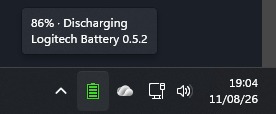
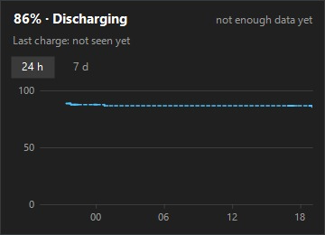
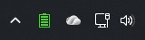

# Logitech Battery Indicator

A small Windows tray app that shows the battery level of a **Logitech PRO X2 SUPERSTRIKE** mouse, without Logitech G HUB.

The tray icon shows the charge at a glance; hover it for the exact percentage. The app reads the mouse directly over Logitech's HID++ protocol, through the Lightspeed receiver or the USB cable.



> Not affiliated with or endorsed by Logitech. Logitech, Logitech G, G HUB, Lightspeed, Logi Options+ and PRO X2 SUPERSTRIKE are trademarks of Logitech.

## Features

- **Battery in the tray** – the icon shows the level and whether the mouse is charging; the tooltip shows the exact percentage.
- **Instant updates** – the tray changes within about a second when the mouse sleeps, wakes, is switched off or on, or when the receiver or cable is plugged in or out.
- **Notifications** – a Windows notification when the battery is low (15 % by default, 10 % or 20 % in the tray menu), critical (5 %) and fully charged (can be switched off in the tray menu).
- **Start with Windows** – on by default, can be switched off in the tray menu. No admin rights needed.
- **History panel** – left-click the tray icon for a 24 h / 7 day graph of the battery level and the time of the last charge.
- **Time left** – an estimate of the hours left, based on how fast the battery drained over the last week.
- **Lightweight and private** – no installer, no background service, no account, no telemetry and no network access. Everything stays on your PC.



## Requirements

- Windows, 64-bit.
- A Logitech PRO X2 SUPERSTRIKE mouse, connected through its Lightspeed receiver or the USB cable. Other Logitech devices are not supported yet.

No .NET installation is needed: the app is a single self-contained `.exe` (about 107 MB, because it contains the .NET runtime uncompressed; this keeps the app at about 12 MB of RAM instead of about 50 MB).

## Install

1. Download `LogitechBattery.exe` from the [latest release](https://github.com/fedemarco/logitech-battery-indicator/releases/latest).
2. Move it to a permanent folder, for example `%LOCALAPPDATA%\LogitechBattery`. "Start with Windows" remembers this location.
3. Run it. The battery icon appears in the tray (you may need to drag it out of the overflow area to keep it visible).

The exe is not code-signed, so Windows SmartScreen may warn the first time. Click **More info → Run anyway**.

To update, exit the app from the tray menu, replace the exe with the new version and start it again.

What's new: see the [releases](https://github.com/fedemarco/logitech-battery-indicator/releases).

## Usage

| Action | Result |
|---|---|
| Hover the tray icon | Status, exact percentage, time left and app version |
| Left-click the tray icon | Opens the history panel; Esc or a click elsewhere closes it |
| Right-click the tray icon | Menu: Notifications (low battery level, fully charged), Start with Windows, Clear history…, Exit |

Icon colors: green from 40 %, yellow from 20 %, red below 20 %. A separate "unknown" icon means the mouse is asleep, switched off or not found.



## Privacy and data

No telemetry. The app sends no data to any server and never connects to the internet. It only stores:

- `%LOCALAPPDATA%\LogitechBattery\log.txt` and `log.old.txt` – a small diagnostic log (rotated, at most about 512 KB). Paths under your user folder are shown as `%USERPROFILE%`.
- `%LOCALAPPDATA%\LogitechBattery\probe.txt` and `listen.txt` – the reports of `--probe` and `--listen`, only when you run those options.
- `%LOCALAPPDATA%\LogitechBattery\history\` – the battery history behind the graph and the time-left estimate, one CSV file per device (kept for one year; **Clear history…** deletes them).
- `%LOCALAPPDATA%\LogitechBattery\settings.ini` – your notification settings, written only when you change one. The app reads it at startup, so exit the app before you edit it by hand.
- `HKCU\Software\Microsoft\Windows\CurrentVersion\Run` – the "Start with Windows" entry, only while that option is on.
- `HKCU\Software\LogitechBattery` – remembers that the first-run "Start with Windows" default was applied.
- `HKCU\Software\Microsoft\Windows\CurrentVersion\Explorer\StartupApproved\Run` – the app only removes its own "disabled" mark here when you turn "Start with Windows" on again after turning it off in Task Manager.

## Uninstall

1. Untick **Start with Windows** in the tray menu, then choose **Exit**.
2. Delete the exe and the folder `%LOCALAPPDATA%\LogitechBattery`.
3. Optionally delete the registry key `HKCU\Software\LogitechBattery`.

## Troubleshooting

If the tray shows "Mouse not found" while the mouse works, wake it (move it) and wait a few seconds. If it stays that way, these options help to find the cause. Run them from PowerShell in the folder of the exe:

```powershell
.\LogitechBattery.exe --probe    # lists the Logitech devices and what they report (probe.txt)
.\LogitechBattery.exe --listen   # records the messages from the mouse and receiver until you click OK (listen.txt)
.\LogitechBattery.exe --mock     # runs with a simulated battery, to check the tray and notifications
```

The reports and `log.txt` are written to `%LOCALAPPDATA%\LogitechBattery`. Please attach them when you [open an issue](https://github.com/fedemarco/logitech-battery-indicator/issues).

These files can contain the times your PC was on and device ids. Versions before 0.5.2 can also contain your Windows user name in a file path. Check them before you attach them.

Not tested yet: running at the same time as Logitech G HUB or Logi Options+.

## Roadmap

- More Logitech devices, with a choice of which one the tray shows.
- Automatic updates.

## Building from source

Requires the [.NET 10 SDK](https://dotnet.microsoft.com/download). The app runs only on Windows, but it builds and its tests run on any OS.

```sh
dotnet build
dotnet test
dotnet publish src/LogitechBattery.App -c Release -o out   # self-contained LogitechBattery.exe for win-x64
```

Every push to `main` builds a development exe in GitHub Actions; a `vX.Y.Z` tag creates a release.

## Contributing

Bug reports and ideas are welcome as [issues](https://github.com/fedemarco/logitech-battery-indicator/issues). For code, open an issue first: the app stays small on purpose. A change must build with 0 warnings (`dotnet build`) and pass `dotnet test`. Security problems: see [SECURITY.md](SECURITY.md).

## Credits

Battery icons from [razer-taskbar](https://github.com/sanraith/razer-taskbar) (MIT), HID access through [HidSharp](https://www.nuget.org/packages/HidSharp) (Apache 2.0). See [THIRD-PARTY-NOTICES.md](THIRD-PARTY-NOTICES.md).

## License

[MIT](LICENSE) © 2026 Federico Marco. Third-party components keep their own licenses (see above).
